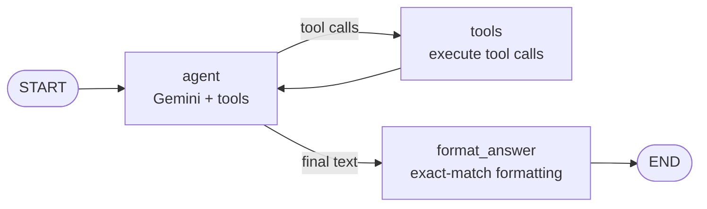

# YAML


# GAIA Agent — LangGraph

An LLM agent that answers real-world questions from the [GAIA benchmark](https://huggingface.co/gaia-benchmark), built with **LangGraph** and **Google Gemini** as the final project of the [Hugging Face AI Agents Course](https://huggingface.co/learn/agents-course).

GAIA questions require web research, reading files (Excel, Python, audio, images), watching YouTube videos, and multi-step reasoning. Answers are graded by **exact match**, so formatting matters as much as correctness.

**Result: 70% (14/20) on the course's Level 1 GAIA evaluation set** (30% required to pass).

This is the second version of the agent. The first, built with smolagents, scored 50%: [GAIA_smolagent](https://huggingface.co/spaces/eidenspark/GAIA_smolagent).

---

## Architecture

The agent is an explicit state graph:



| Node | Role |
|---|---|
| `agent` | Gemini with tools bound via function calling. Decides whether to call a tool or answer. |
| `tools` | LangGraph `ToolNode`: runs the requested tools and appends their results to the conversation. |
| `format_answer` | A separate, cheaper model call that extracts only the final answer in the format the question requires, followed by deterministic cleanup. |

**State** (`AgentState`) holds the message history (appended with `add_messages`), the original question, and the final answer. A `recursion_limit` caps the number of tool rounds per question.

---

## Tools

| Tool | What it does |
|---|---|
| `web_search` | DuckDuckGo search with retries and backoff (handles rate limiting) |
| `wikipedia_search` | Search via the official Wikipedia API: a reliable second search source |
| `visit_webpage` | Fetches a page with a proper User-Agent, strips navigation and clutter, returns markdown |
| `read_table_file` | Reads Excel/CSV files with pandas (all sheets) |
| `read_text_file` | Reads text and code files |
| `analyze_media_file` | Audio transcription and image/PDF analysis with Gemini's multimodal API |
| `analyze_youtube_video` | Answers questions about public YouTube videos with Gemini |
| `run_python` | Executes Python in a subprocess with a timeout, for exact math, counting and data processing |

---

## Key design decisions

- **Model fallback.** Free-tier Gemini quotas are small, so the agent uses LangChain's `.with_fallbacks()` to move down a list of models (strongest first) on quota or overload errors. The formatting step starts with the cheapest model to save the strong models' quota for reasoning.
- **Formatting as its own node.** Exact-match grading punishes extra words ("The answer is…"). A dedicated formatting step proved more reliable than relying on the agent's prompt alone, and it never replaces a real answer with an empty one.
- **Two search sources.** DuckDuckGo throttles traffic from shared cloud IPs, which made the agent look like it "couldn't find" things. The Wikipedia API provides a dependable fallback.
- **Respectful web access.** Wikipedia rejects requests without an identifying User-Agent, so all web tools send one.
- **File handling.** Task files are downloaded from the course API, falling back to the official GAIA dataset when the API returns 404.

---

## Lessons learned

- Most of agent engineering is **reliability**: rate limits, blocked requests, empty model replies and strict output formats caused more failures than reasoning did.
- **Evaluation needs care.** Two runs on the same day share one API quota, so the second run is handicapped. Fair comparisons need equal conditions.
- **Read the traces.** Every improvement came from reading agent logs and fixing a general cause (a tool bug, a missing capability), not from tailoring prompts to specific questions.

---

## Limitations and next steps

- `run_python` runs ordinary Python in a subprocess. It is **not a security sandbox** and is only suitable for trusted benchmark tasks; a production system would use an isolated container.
- Visual reasoning tasks (for example, chess positions from images) remain unreliable.
- Planned: a best-guess answer step when the step budget runs out (instead of returning no answer), and tracing with Langfuse/LangSmith for observability.

---

## Project structure

```
app.py           # Gradio app: fetches questions, runs the agent, submits answers
agent.py         # LangGraph graph: state, nodes, model fallbacks, GaiaAgent wrapper
tools.py         # All tools (search, web, files, media, YouTube, Python)
utils.py         # Task file download (course API, GAIA dataset fallback)
requirements.txt
```

## Run locally

```bash
pip install -r requirements.txt
# .env needs GEMINI_API_KEY (and HF_TOKEN for the GAIA dataset fallback)
python test_graph.py      # run one question
python app.py             # launch the Gradio evaluation app
```

---

Built by [Amir Seken](https://huggingface.co/eidenspark) · Hugging Face AI Agents Course